# Amazon E Commerce Sales Performance Analysis | Python | Tableau

---

## 🗂️ Project Overview
Pertumbuhan bisnis <i>e-commerce</i> menghasilkan volume data transaksi yang besar, mulai dari penjualan, kategori produk, wilayah pengiriman, metode fulfillment, hingga status pesanan. Namun, data transaksi dalam jumlah besar belum tentu memberikan gambaran yang jelas mengenai performa bisnis apabila belum dianalisis secara terstruktur.

Project ini menganalisis data transaksi Amazon <i>e-commerce</i> selama trimester kedua tahun 2022, untuk mengevaluasi performa penjualan dan mengidentifikasi pola penjualan. Analisis dilakukan dimulai dengan melakukan data <i>preparation</i>, data <i>cleaning</i>, dan <i>Exploratory Data Analysis (EDA)</i> menggunakan Python, kemudian divisualisasikan dalam bentuk <i>dashboard</i> interaktif menggunakan Tableau.

<b> Business Questions</b>
Analisis ini berfokus pada beberapa pertanyaan utama, sebagai berikut.
- Bagaimana perkembangan penjualan selama periode yang dianalisis, dan kapan terjadi perubahan atau penurunan yang signifikan?
- Kategori produk mana yang memberikan kontribusi terbesar terhadap penjualan, dan kategori mana yang mengalami penurunan paling besar?
- Apakah penjualan terkonsentrasi pada wilayah tertentu, dan wilayah mana yang memberikan kontribusi terbesar terhadap penjualan?
- Bagaimana perbedaan sales antara fulfillment Amazon dan Merchant, dan apakah perbedaan tersebut berkaitan dengan volume order?
- Seberapa besar proporsi order yang berada pada status Unshipped atau Cancelled, dan apakah masalah tersebut lebih terkonsentrasi pada fulfillment tertentu?

---

## 🔑 Key Findings
|Fokus Analisis|Key Finding|
|---|---|
|**Sales Performance**|Penjualan mengalami **penurunan** setelah mencapai **puncak penjualan** pada Bulan **April** senilai ₹30,6 juta Rupee, menjadi ₹24,8 juta Rupee pada Bulan **Juni**|
|**Category**|**Set** menjadi kategori dengan kontribusi **penjualan terbesar**, yaitu sekitar ₹41,0 juta Rupee, tetapi **penjualannya menurun** setelah **April**|
|**Geographic Performance**|**Maharashtra** menjadi wilayah dengan **penjualan tertinggi**, mencapai sekitar ₹13,97 juta Rupee. **Lima wilayah** dengan penjualan tertinggi berkontribusi sebesar **55,9%** terhadap total penjualan|
|**Order Status**|Penjualan melalui fulfillment Amazon mencapai sekitar **2,3 kali lipat** dibandingkan dengan Merchant|
|**Fulfillment**|Proporsi transaksi berstatus **Unshipped dan Cancelled** pada fulfillment Amazon mencapai sekitar **13,5%**, lebih tinggi dibandingkan Merchant yang sebesar 1,3%|

## 🧭 Project Workflow
Analisis dilakukan melalui beberapa tahapan berikut.
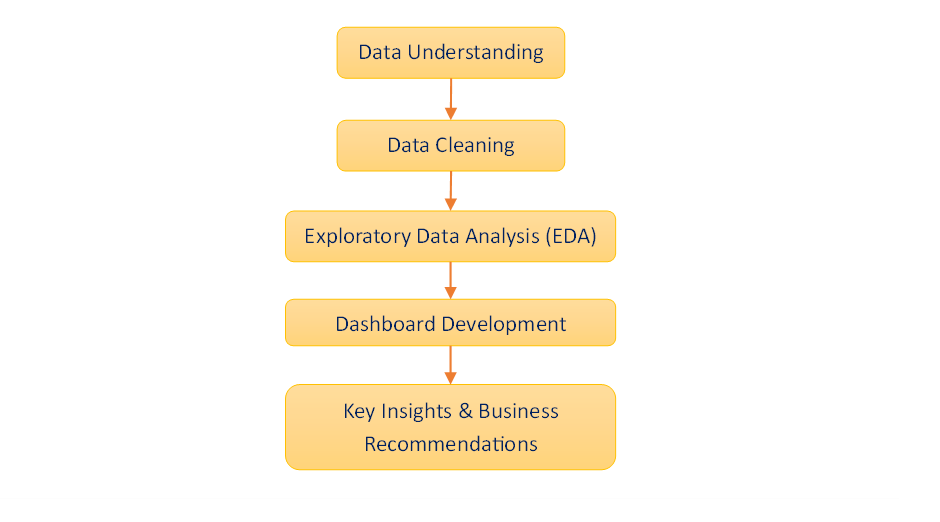

---

## ⚙️ Data Preparation
**Data Understanding**

Analisis dilakukan menggunakan dataset Amazon E-Commerce Sales yang terdiri dari 128.975 baris dan 24 kolom.

|**Kolom**|**Deskripsi**|
|---|---|
|`order_id`|ID transaksi|
|`date`|Tanggal transaksi|
|`status`|Status pesanan|
|`fulfilment`|Metode fulfilment yang digunakan|
|`sales_channel`|Channel penjualan|
|`ship_service_level`|Tingkat layanan pengiriman|
|`size`|Ukuran produk|
|`courier_status`|Status pengiriman|
|`qty`|Jumlah produk dalam transaksi|
|`amount`|Nilai penjualan|
|`ship_state`|Wilayah tujuan pengiriman|
|`B2B`|Business to Business|
> 13 dari 24 kolom digunakan dalam analisis, dipilih berdasarkan relevansi terhadap tujuan analisis dan business questions.

**Data Cleaning**

Dilakukan pemeriksaan dan perbaikan kualitas data sebagai berikut sebelum dilakukan analisis.

|**Issue**|**Finding**|**Handling**|
|---|---|---|
|**Column names**|Terdapat beberapa nama kolom dengan format penamaan yang tidak konsisten dan mengandung spasi (whitespace)|Menyesuaikan nama kolom|
|**Data types**|Tipe data kolom `date` tidak sesuai|Mengubah tipe data kolom `date` <i>string</i> menjadi <i>datetime</i>|
|**Inconsistent value**|Kolom `ship_state` memiliki nilai yang salah dan tidak konsisten|Menyesuaikan nilai kolom `ship_state`|
|**Duplicate data**|Terdapat 785 data duplikat|Menghapus data duplikat|
|**Missing value**|Terdapat 6.872 <i>missing value</i> pada kolom `courier_status`|Mengatasi <i>missing value</i> dengan mengisi menggunakan nilai modus dari kolom `courier_status`
||Terdapat 7.795 <i>missing value</i> pada kolom `amount`|Mengatasi <i>missing value</i> dengan mengisi menggunakan nilai median dari kolom `amount`
||Terdapat 33 <i>missing value</i> pada kolom `ship_state`|Menghapus setiap baris kolom `ship_state` yang mengandung <i>missing value</i> (total <i>missing value</i> <5% dari banyak seluruh data)

---

## 🔎 Analysis Highlights
**Monthly Sales Performance**

  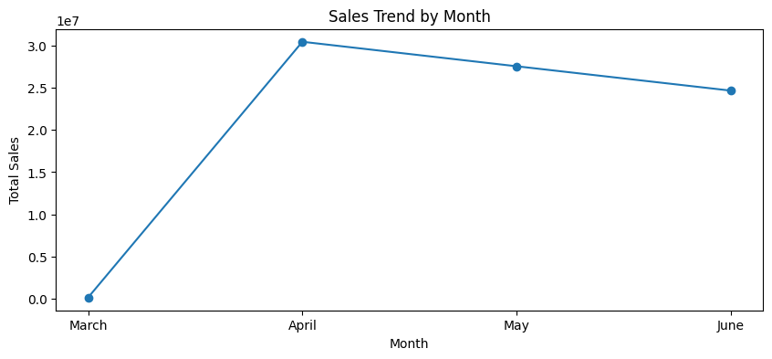
  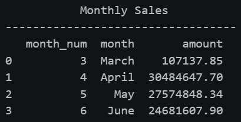

Penjualan mengalami peningkatan signifikan dari Bulan Maret ke April mencapai nilai tertinggi sebesar ₹30,5 juta Rupee, kemudian menurun secara linear pada Bulan Mei hingga Juni menjadi sebesar ₹27,6 juta hingga ₹24,7 juta Rupee. Penjualan pada bulan Maret jauh lebih rendah daripada bulan lainnya, karena data pada bulan tersebut hanya mencakup satu hari transaksi yaitu pada tanggal 31 Maret 2022. 

**Category Sales Contribution**

  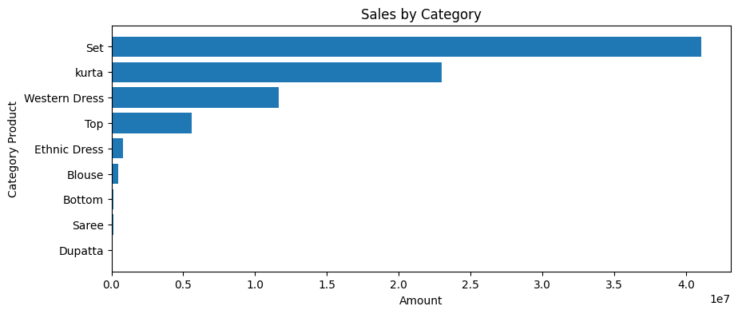
  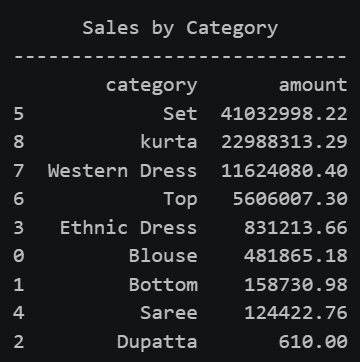

Distribusi penjualan berdasarkan kategori menunjukkan bahwa Set merupakan kontributor terbesar terhadap penjualan dengan nilai mencapai ₹41 juta Rupee, diikuti oleh Kurta sebesar ₹23 juta Rupee, dan Western Dress sebesar ₹11,6 juta Rupee. Sementara itu, Dupatta menjadi kategori dengan kontribusi terendah terhadap penjualan, yaitu sebesar ₹610 Rupee.

  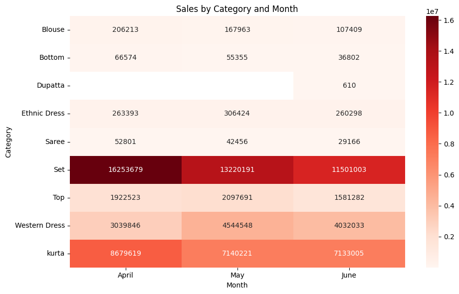
  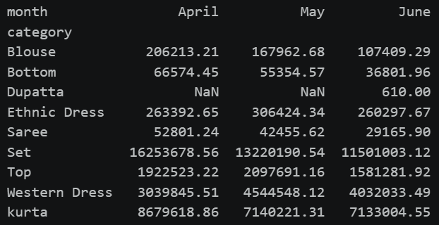

Analisis berdasarkan penjualan setiap kategori pada setiap bulan, menunjukkan bahwa kategori Set juga mengalami penurunan penjualan setelah April. Penjualan kategori Set pada Bulan April sebesar ₹16,3 juta Rupee menjadi ₹13,2 juta Rupee pada Bulan Mei, dan ₹11,5 juta Rupee pada Bulan Juni. Pola serupa juga terlihat pada beberapa kategori lainnya dengan besar penurunan berbeda antar kategori.  Penurunan pada kategori Set perlu diperhatikan, karena kategori tersebut merupakan kotributor penjualan terbesar.

**Geographic Sales Analysis**
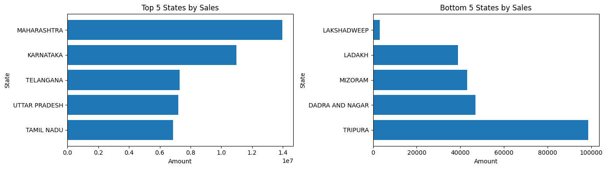

  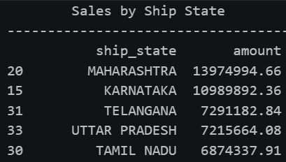
  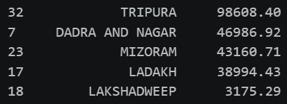

Distribusi penjualan berdasarkan wilayah menunjukkan perbedaan signifikan. Wilayah Maharashtra menjadi wilayah dengan penjualan tertinggi sebesar ₹13,8 juta Rupee, diikuti oleh Karnataka sebesar ₹11 juta Rupee, dan Telangana sebesar ₹7,3 juta Rupee. Sementara Wilayah Lakshadweep memiliki penjualan terendah sebesar ₹3,2 ribu Rupee. Hal ini menunjukkan adanya kesenjangan yang cukup besar antara wilayah dengan penjualan tertinggi dan terendah.

  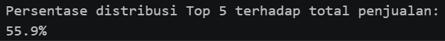

Secara keseluruhan, 5 wilayah dengan penjualan tertinggi berkontribusi hingga 55,9% dari total penjualan, yang menunjukkan bahwa penjualan hanya terkonsentrasi pada beberapa wilayah utama.

**Fulfilment Analysis**

  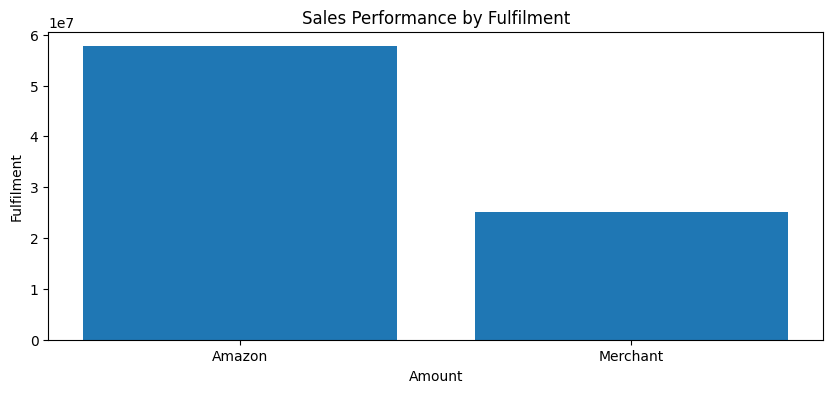
  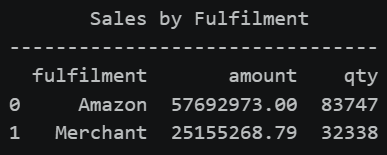

Penjualan berdasarkan metode fulfilment, menunjukkan bahwa Amazon menghasilkan penjualan sebesar ₹57,7 juta Rupee, 2,3 kali lebih besar dibandingkan Merchant sebesar ₹25,2 juta Rupee. Perbedaan serupa juga terlihat pada volume produk (quantity), dengan Amazon mencapai sebanyak 83.747 unit, sedangkan Merchant sebanyak 32.338 unit. Tingginya penjualan pada metode fulfilment Amazon linear dengan volume produk yang lebih tnggi dibandingkan Merchant.

**Order Status Distribution**

  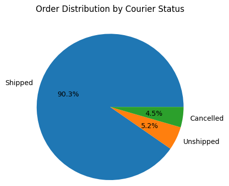
  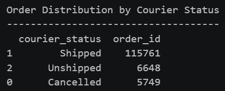

Sebagian besar transaksi telah terkirim, namun masih terdapat sebagian transaksi belum terkirim atau dibatalkan. Distribusi transaksi pembelian berdasarkan status pengiriman menunjukkan bahwa 90,3% transaksi telah terkirim, sementara 5,2% belum terkirim, dan 5% dibatalkan.

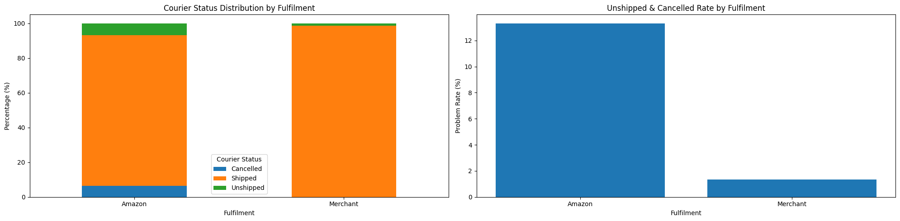
Berdasarkan metode fulfillment, Amazon memiliki proporsi transaksi dengan status Unshipped dan Cancelled yang lebih tinggi dibandingkan Merchant. Problem rate pada Amazon mencapai sekitar 13,5%, sedangkan Merchant hanya sekitar 1,3%. Hal ini menunjukkan bahwa meskipun Amazon memiliki kontribusi penjualan yang lebih besar, Amazon juga memiliki proporsi transaksi bermasalah yang lebih tinggi dibandingkan Merchant.

**Dashboard Details**
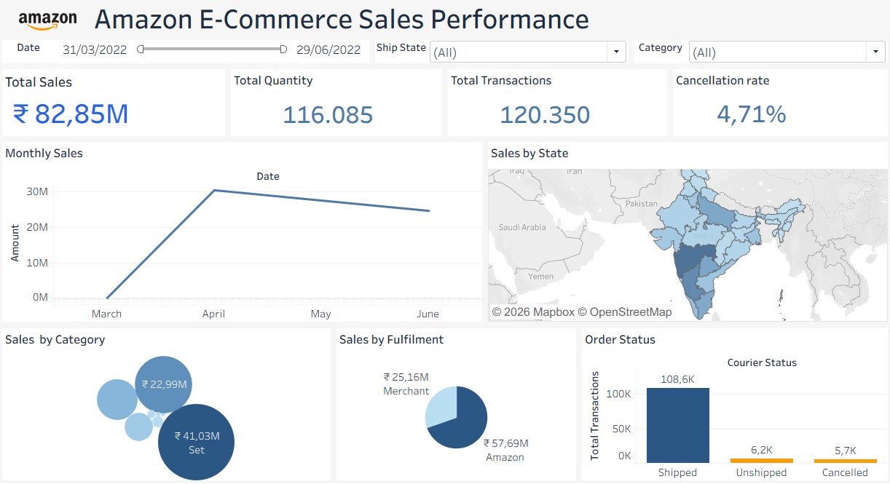

---

## 💡Key Insights

**1. Penurunan penjualan perlu diperhatikan**

Penjualan mencapai puncaknya pada April, kemudian mengalami penurunan secara bertahap hingga Juni. Pola ini menunjukkan adanya penurunan performa penjualan setelah April yang perlu diperhatikan karena dapat memengaruhi pencapaian penjualan secara keseluruhan apabila berlanjut.

**2. Kategori Set sangat berpengaruh terhadap performa penjualan**

Set menjadi kategori dengan kontribusi penjualan terbesar. Namun, kategori ini juga mengalami penurunan penjualan terbesar setelah April dibandingkan kategori lainnya. Hal ini menunjukkan bahwa performa kategori Set memiliki peran penting terhadap penjualan secara keseluruhan, sehingga penurunan pada kategori tersebut berpotensi memberikan dampak yang signifikan terhadap performa penjualan.

**3. Penjualan terkonsentrasi pada beberapa wilayah utama**

Lima wilayah dengan penjualan tertinggi menyumbang sekitar 55,9% dari total penjualan, dengan Maharashtra sebagai kontributor terbesar. Hal ini menunjukkan bahwa beberapa wilayah memiliki peran penting terhadap performa penjualan. Mempertahankan performa di wilayah utama sekaligus mengembangkan pasar lain dapat menjadi pendekatan untuk mendukung pertumbuhan penjualan.

**4. Amazon menjadi channel fulfillment utama, tetapi memiliki problem rate lebih tinggi**

Metode fulfillment Amazon menghasilkan penjualan sekitar 2,3 kali lebih tinggi dibandingkan Merchant. Namun, proporsi transaksi berstatus Unshipped dan Cancelled pada Amazon juga jauh lebih tinggi. Hal ini menunjukkan bahwa meskipun Amazon menjadi kontributor penjualan yang lebih besar, proporsi transaksi bermasalah pada metode fulfillment tersebut juga lebih tinggi dibandingkan Merchant.

---

## 🎯 Business Recommendations
**1. Evaluasi Tren Penjualan:** Memantau tren penjualan bulanan dan mengevaluasi faktor yang berkaitan dengan penurunan penjualan.

**2. Optimasi Kategori Produk:** Mempertahankan performa kategori Set dan mengembangkan kategori lain yang berpotensi meningkatkan penjualan.

**3. Pengembangan Pasar:** Mempertahankan penjualan di wilayah utama dan mengidentifikasi peluang pasar di wilayah lain.

**4. Pemantauan Order:** Memantau transaksi Unshipped dan Cancelled pada fulfillment Amazon untuk mendukung evaluasi operasional.

---

## ⚠️ Limitations
Data pada Bulan Maret hanya mencakup tanggal 31 Maret 2022, sehingga tidak dapat dibandingkan secara langsung dengan bulan April hingga Juni yang memiliki cakupan data lebih panjang.

---

## 🛠️ Tools
|**Purpose**|**Tools**|
|---|---|
|Data Cleaning & EDA|`Python`|
|Dashboard|`Tableau`|

---

## 🔗 Read More
- **💾 Dataset:** [Amazon E-Commerce Sales Dataset - Kaggle](https://www.kaggle.com/datasets/thedevastator/unlock-profits-with-e-commerce-sales-data?resource=download)
- **🧹 Data Cleaning on Python:** [Step by Step Data Cleaning - Notebook](https://github.com/yyunitasa-stack/Amazon-E-Commerce-Sales-Performance-Analysis/blob/main/Data%20Cleaning%20%26%20EDA/Step%20by%20Step%20Data%20Cleaning_Amazon%20E-Commerce.ipynb)
- **🔬 Exploratory Data Analysis:** [View Notebook](https://github.com/yyunitasa-stack/Amazon-E-Commerce-Sales-Performance-Analysis/blob/main/Data%20Cleaning%20%26%20EDA/EDA_Amazon%20E-Commerse.ipynb)
- **📊 Dashboard:** [View Dashboard](https://public.tableau.com/app/profile/yunita.ayu.indah.sari/viz/AmazonE-commerceSalesPerformance/Dashboard?publish=yes)